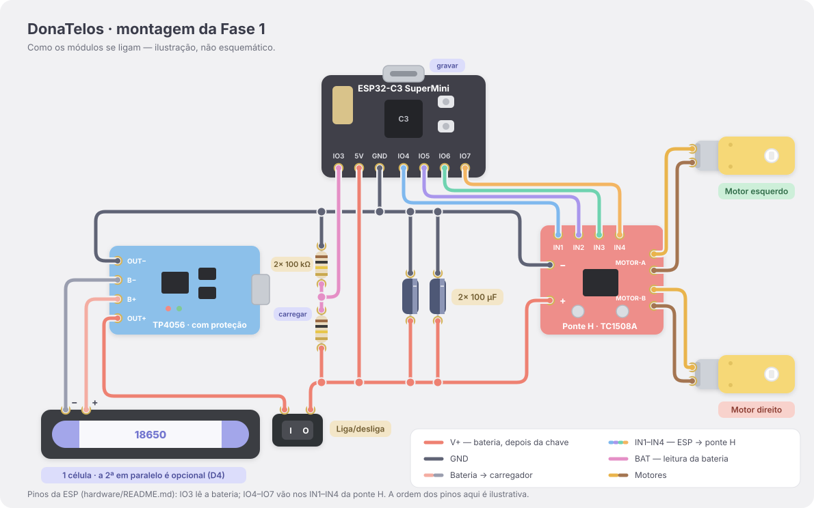

# Montagem — Fase 1

Como as peças da Fase 1 se ligam: bateria, carregador, chave, ESP, ponte H e
os dois motores.

> 🖼️ **Ilustração, não esquemático.** O desenho mostra quem liga em quem, no
> estilo dos diagramas de montagem — cantos arredondados, cores pastel. A
> pinagem de verdade (qual GPIO da ESP vai em cada IN e no BAT) nasce no
> esquemático, em [hardware/](../hardware/), e o desenho copia de lá. Até
> lá, esses pinos levam `*`.

## 1. O caminho da energia

1. **Bateria → carregador.** Os fios do suporte da 18650 vão no **B+** e no
   **B−** do TP4056.
2. **Carregador → chave.** O **OUT+** passa pela chave liga/desliga. O
   **OUT−** vira o GND de todo mundo — e é no OUT−, não no B−, porque a
   proteção do módulo corta pelo negativo. Ligado no B−, o barco descarregaria
   a célula sem proteção nenhuma.
3. **Depois da chave, o V+** alimenta a ponte H (+), a ESP (pino 5V), os
   capacitores e o divisor.
4. **Os capacitores** ficam entre V+ e GND, perto da ponte H: são o
   amortecedor contra o brownout quando o motor força (esboço, seção 5.3).
   **Eletrolítico tem lado:** a faixa clara é o −.
5. **O divisor** — dois resistores de 100 kΩ — entrega metade da tensão da
   bateria pra ESP ler. É o nível de bateria que aparece na página do celular.
   Se a metade cabe na faixa do ADC, o esquemático confere no datasheet.

**A conferir na bancada:** a bateria entra direto no pino 5V da SuperMini, que
passa pelo regulador da própria placa. Com a célula descarregando, sobra pouca
folga pra esse regulador. Até onde a ESP aguenta, a fonte de bancada responde
antes da bateria (já está nos cuidados de [hardware/](../hardware/CLAUDE.md)).

## 2. As ligações

| De | Para | Fio | Obs. |
| --- | --- | --- | --- |
| Suporte da bateria (+) | TP4056 B+ | coral claro | Pelo borne da bateria |
| Suporte da bateria (−) | TP4056 B− | cinza claro | Pelo borne da bateria |
| TP4056 OUT+ | Chave | coral | |
| Chave | Ponte H (+), ESP (5V), capacitores (+), divisor | coral (V+) | |
| TP4056 OUT− | Ponte H (−), ESP (GND), capacitores (−), divisor | grafite (GND) | |
| ESP IN1\*–IN4\* | Ponte H IN1–IN4 | azul, lilás, verde, laranja | Dois pinos por motor |
| Meio do divisor | ESP BAT\* | rosa | Tem que ser pino com ADC |
| Ponte H MOTOR-A | Motor esquerdo | âmbar e marrom | Pelo borne |
| Ponte H MOTOR-B | Motor direito | âmbar e marrom | Pelo borne |

Motor girando ao contrário não é defeito: troque os dois fios dele no borne
(ou o firmware inverte).

## 3. Na placa 5×7 — ordem sugerida

1. **Barra macho** na SuperMini e na ponte H. Dica: espete a barra macho na
   fêmea, encaixe na placa e só então solde — sai reto.
2. **Barras fêmea** na placa, onde a ESP e a ponte H encaixam. Trocar peça
   queimada vira tirar e pôr.
3. **Três bornes:** bateria e os dois motores.
4. **Capacitores** perto da ponte H, conferindo a faixa do −.
5. **Divisor** perto da ESP.
6. **V+ e GND** com fio pela placa, depois os sinais IN1–IN4 e BAT.
7. **Chave** fora da placa, no fio do OUT+, num lugar que dê pra alcançar com
   o barco montado.
8. **Antes da bateria:** multímetro em continuidade entre V+ e GND — não pode
   apitar. Depois, a primeira vez liga pela **fonte de bancada, com limite de
   corrente**. A bateria vem só depois.

## 4. Em aberto

- **Os GPIOs** de IN1–IN4 e BAT: saem do esquemático, fugindo dos pinos de
  boot e do USB (cuidados em [hardware/](../hardware/CLAUDE.md)).
- **A segunda célula** (D4): se entrar, vai em paralelo com a primeira, no
  mesmo B+/B−, com o cuidado da
  [lista de materiais](lista-de-materiais.md#3-quando-a-caixa-chegar).
- **A ESP direto da célula:** conferir na bancada.
- **Onde cada coisa fica no casco:** depende do pote e do isopor
  ([plano do casco](plano-do-casco.md)).
