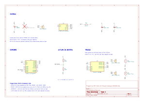

# hardware/

A parte elétrica do barco: esquemático, ligações e a pinagem.

> 🚧 **Esquemático da Fase 1 pronto**, no KiCad 10, com a checagem elétrica
> (ERC) limpa. Montagem com módulos numa placa perfurada, sem PCB de fábrica
> (D8). Como fica na mão: [docs/montagem.md](../docs/montagem.md).



## Pinagem

**É daqui que o firmware tira os números — nunca o contrário.**

| Função | Pino da SuperMini | Rede | Por quê |
| --- | --- | --- | --- |
| Leitura da bateria | GPIO3 | `BAT_SENSE` | ADC1, que funciona junto com o Wi-Fi; a 12 dB lê de 0 a 2500 mV (datasheet, p. 57) |
| Motor esquerdo, entrada 1 | GPIO4 | `IN1` | Livre no boot |
| Motor esquerdo, entrada 2 | GPIO5 | `IN2` | Livre no boot |
| Motor direito, entrada 1 | GPIO6 | `IN3` | Livre no boot |
| Motor direito, entrada 2 | GPIO7 | `IN4` | Livre no boot |
| LED amarelo (alerta) | GPIO1 | `LED_Y` | Livre no boot; deixa o GPIO0 livre pra um sensor analógico |
| LED verde (status) | GPIO10 | `LED_G` | Livre no boot, e não é ADC: não gasta pino analógico |
| LED vermelho (alimentação) | 3V3 | `3V3` | Direto, sem firmware: aceso = placa alimentada |
| LED da placa | GPIO8 | — (na placa) | Sem uso: o status foi pro LED verde. Pino de boot |
| Botão BOOT | GPIO9 | — (na placa) | Pino de boot |
| Alimentação | 5V | `V+` | Entrada do regulador da placa |
| Terra | GND | `GND` | |

Ficaram livres: GPIO0, 2, 20 e 21. Os motores e os LEDs fogem dos pinos
de boot (GPIO2, 8 e 9, datasheet p. 30) e do GPIO20/21, que é a serial onde o
chip escreve quando liga — ligado num motor, daria um tranco no boot.

Fonte: [ESP32-C3 Series Datasheet v2.5](https://documentation.espressif.com/esp32-c3_datasheet_en.pdf),
páginas citadas na tabela. Os pinos que a SuperMini expõe vêm da
[página da placa](https://www.espboards.dev/esp32/esp32-c3-super-mini/).

## O caminho da energia

Bateria → TP4056 (B+/B−) → OUT+ pela chave → **V+**, que alimenta a ponte H, a
ESP (pino 5V), os capacitores e o divisor. O **GND** de todo mundo é o OUT− do
TP4056 — a proteção dele corta pelo negativo.

**A conferir na bancada:** a ESP aceita 3,0–3,6 V (datasheet, p. 55), e a
bateria entra no 5V da SuperMini, passando pelo regulador da placa. Com a
célula descarregando, sobra pouca folga. Até onde ela aguenta, a fonte de
bancada responde — antes de confiar na bateria.

## Sinalização

Três LEDs comuns de 5 mm, cada um com o seu resistor, pra ler o barco de
longe — inclusive na água, sem o celular na mão.

| LED | Liga em | Resistor | O que diz |
| --- | --- | --- | --- |
| Vermelho (D1) | 3V3, direto | 1 kΩ (R3) | Aceso = placa alimentada. Acende até com o firmware travado |
| Verde (D2) | GPIO10 | 330 Ω (R4) | Status: pisca devagar esperando o celular; aceso, no controle |
| Amarelo (D3) | GPIO1 | 330 Ω (R5) | Alerta: pisca rápido no failsafe; aceso com bateria baixa |

**A conta do resistor** é I = (3,3 V − Vf) / R, e o Vf (a queda do LED) é
*estimativa* até medir: perto de 2 V no vermelho e no amarelo comuns, o que
dá ~1,3 mA no de 1 kΩ e ~4 mA nos de 330 Ω. O vermelho fica no 1 kΩ porque
fica aceso o tempo todo: menos corrente, mais autonomia.

**Verde: compre o comum (difuso), não o de alto brilho.** O verde "puro" tem
Vf perto de 3 V (*estimativa*) e, com 3,3 V, quase não acende. Na dúvida,
meça a queda com o multímetro no modo diodo antes de soldar.

## Componentes

| Ref. | O quê | Fonte |
| --- | --- | --- |
| U1 | ESP32-C3 SuperMini | [datasheet do chip](https://documentation.espressif.com/esp32-c3_datasheet_en.pdf), [página da placa](https://www.espboards.dev/esp32/esp32-c3-super-mini/) |
| U2 | TP4056 com proteção | [página da loja](https://www.casadarobotica.com.br/sensores-e-modulos/modulos/carregadores/modulo-carregador-de-baterias-de-litio-tp4056-com-protecao) |
| U3 | Ponte H dupla TC1508A | [página da loja](https://www.casadarobotica.com/ver-mais/mini-driver-motor-ponte-h) |
| M1, M2 | Motor TT 1:48 | [desenho do fabricante](https://www.adafruit.com/product/3777) |
| BT1 (BT2) | 18650 GoldHill — a segunda é opcional (D4) | [página da loja](https://www.casadarobotica.com.br/fontes-conversores/fontes/outros/1x-bateria-3-7v-18650-de-litio-recarregavel-goldhill) |
| SW1 | Chave gangorra KCD11 | — |
| C1, C2 | 100 µF 16 V | — |
| R1, R2 | 100 kΩ (divisor da bateria) | — |
| D1–D3 | LED 5 mm difuso: vermelho, verde e amarelo | — |
| R3 | 1 kΩ (LED vermelho) | — |
| R4, R5 | 330 Ω (LEDs verde e amarelo) | — |
| J1–J3 | Borne KF301, 2 vias | — |

A lista completa, com preço: [docs/lista-de-materiais.md](../docs/lista-de-materiais.md).

## Arquivos

```
kicad/
  donatelos.kicad_pro    projeto KiCad 10
  donatelos.kicad_sch    o esquemático
  donatelos.kicad_sym    símbolos próprios (módulos, motor, borne...)
  sym-lib-table          aponta pra biblioteca acima
esquematico.svg          o esquemático exportado, pra ler no GitHub
```

## Bancada disponível

| Item | Serve pra |
| --- | --- |
| Fonte de bancada | Alimentar com limite de corrente antes de confiar na bateria |
| Osciloscópio de 1 canal | Ver a queda de tensão quando o motor trava (o brownout da seção 5.3 do esboço) |
| Multímetro | Continuidade antes de ligar, tensão das células antes do paralelo |
| ESP32-C3 SuperMini | O cérebro do barco — já tem uma na mão |
