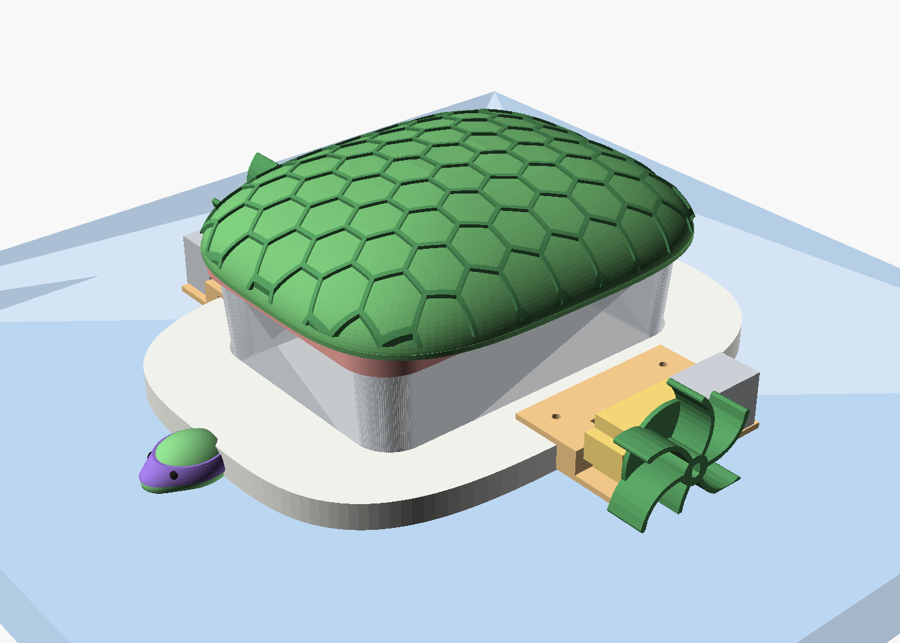
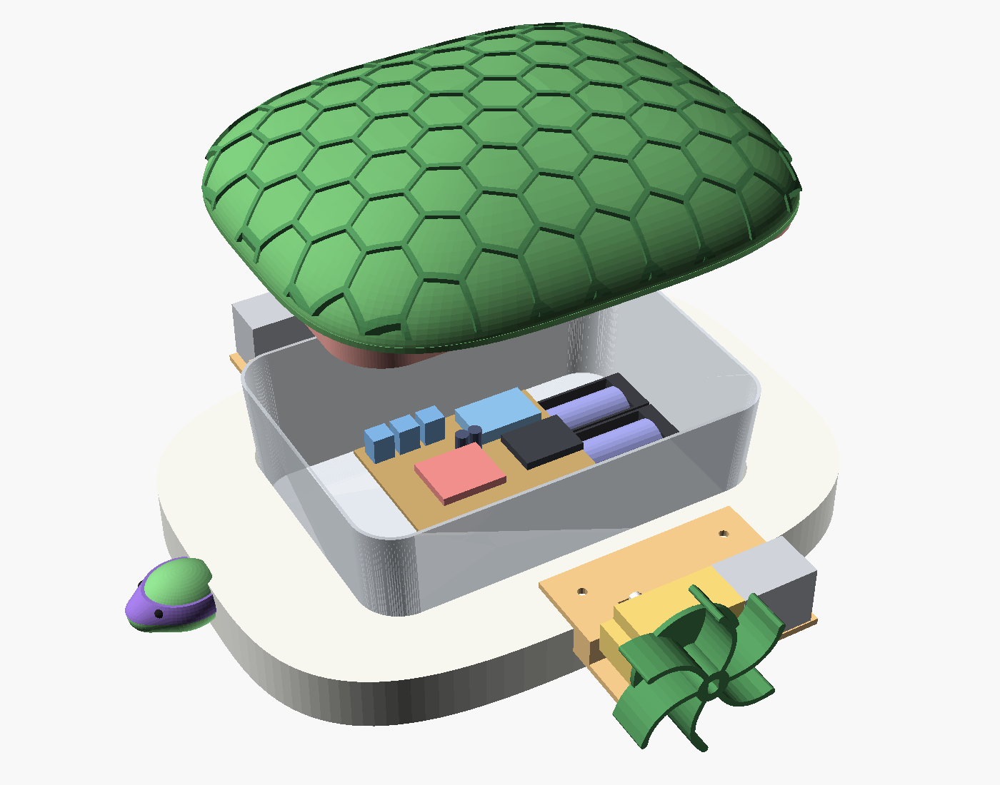
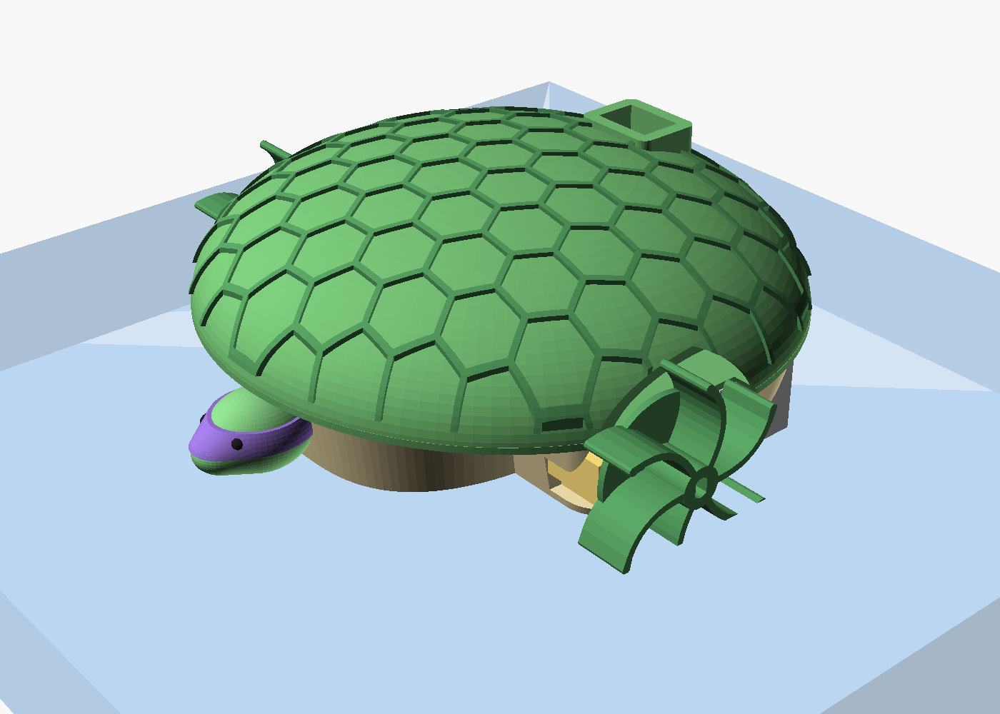
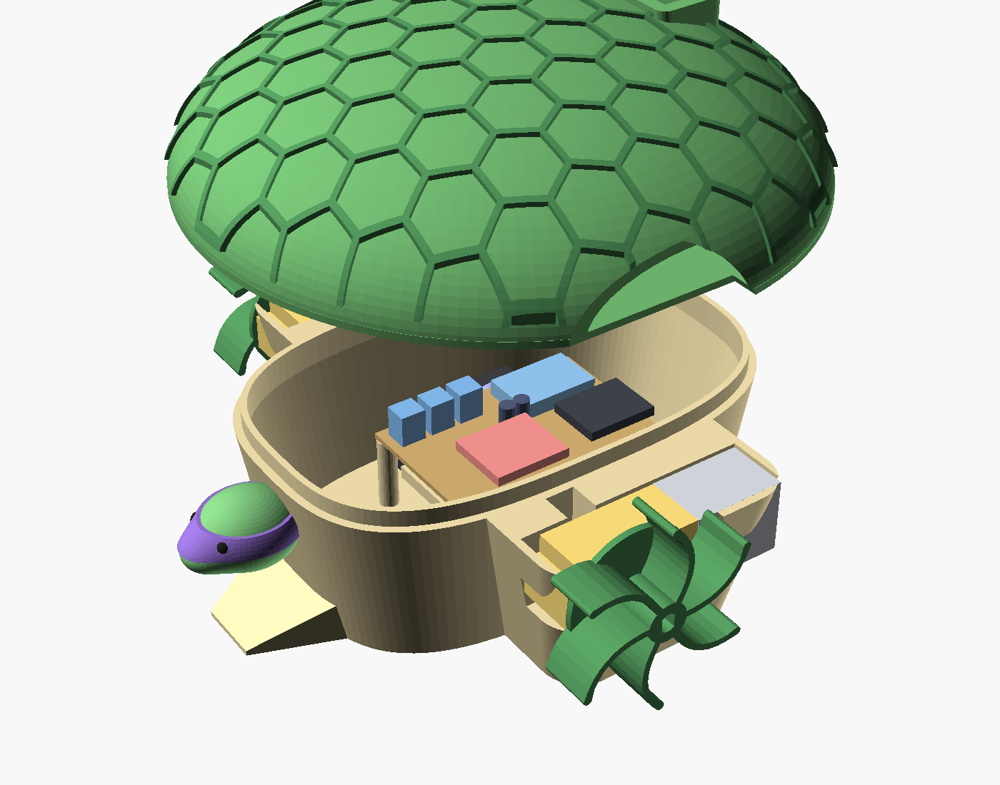

# mechanics/

O corpo da tartaruga: casco, carapaça, rodas-nadadeira, suportes — tudo que vai
pra impressora 3D.

> 🚧 **Modelos paramétricos em OpenSCAD**, com as medidas que ainda não foram
> conferidas marcadas como *a medir* ou *chute*. O casco tem dois caminhos
> ([plano do casco](../docs/plano-do-casco.md)): **A**, pote e isopor — o
> escolhido por ora — e **B**, tudo impresso. Os dois estão projetados aqui,
> com a mesma roda de pá e a mesma cabeça.

## Caminho A — pote e isopor (o escolhido, por ora)



O pote encaixa num furo da placa de isopor, com o fundo rente ao fundo dela.
Um **suporte impresso** de cada lado prende o motor TT na borda do isopor —
uma aba deita em cima (presa com palito de churrasco espetado e um pouco de
cola), um bloco encosta na lateral e uma bandeja segura o motor pra fora, com
duas abraçadeiras. A **carapaça** vai colada em cima da tampa do pote: abriu a
tampa, abriu a tartaruga. A cabeça cola na frente do isopor.



Dentro do pote: as baterias no fundo e a placa em cima. A chave liga/desliga
fica lá dentro também — abre a tampa pra ligar.

| Peça | Arquivo | Caixa (mm) | Filamento (*estimativa*) |
| --- | --- | --- | --- |
| Suporte do motor (×2) | [pot/motor_mount.scad](pot/motor_mount.scad) | 13 × 51 × 76 | ~10 g cada |
| Roda de pá (×2) | [paddle_wheel.scad](paddle_wheel.scad) | 52 × 59 × 16 | ~7 g cada |
| Cabeça | [printed/head.scad](printed/head.scad) | 22 × 28 × 29 | ~3 g |
| Carapaça (Fase 2) | [pot/carapace.scad](pot/carapace.scad) | 177 × 147 × 35 | ~67 g |
| **Total** | | | **~37 g na Fase 1; ~104 g com a carapaça** |

**Molde do isopor em tamanho real:**
[renders/pot_raft_template.svg](renders/pot_raft_template.svg) — imprime em
A4 paisagem, **escala 100%**, e confere a régua de 50 mm desenhada nele. Tem o
contorno, o furo do pote e onde vão os suportes.

**Linha d'água estimada: ~9 mm** (barco na casa de 310 g). O isopor quase não
afunda, então a roda é que precisa descer até a água: o eixo fica só 4 mm
acima do topo do isopor, e a pá molha ~13 mm.

**Tudo depende das medidas do pote** — as do modelo são *chute* pela foto
(155 × 110 × 55 mm). Com a régua, é só trocar em `pot/pot_params.scad`.

## Caminho B — tudo impresso



O **plastrão** (a casca de baixo) é uma banheira com bico de cunha na proa e
um flutuador de cada lado, onde o motor encaixa por cima. A **carapaça** é o
domo com gomos em relevo; ela assenta na borda, prende os motores no berço e
deixa as rodas de pá saírem por dois arcos — as nadadeiras. Atrás, uma
torrinha com a chave liga/desliga. Na frente, a cabeça, de bandana roxa.



Por dentro: as duas baterias atravessadas no fundo (lastro) e a placa 5×7 em
cima delas, em quatro colunas. Fechado, o ar preso em cima faz a tartaruga
desvirar sozinha.

| Peça | Arquivo | Caixa (mm) | Filamento (*estimativa*) |
| --- | --- | --- | --- |
| Plastrão | [printed/plastron.scad](printed/plastron.scad) | 166 × 165 × 53 | ~92 g |
| Carapaça | [printed/carapace.scad](printed/carapace.scad) | 173 × 174 × 41 | ~72 g |
| Cabeça | [printed/head.scad](printed/head.scad) | 22 × 28 × 29 | ~3 g |
| Roda de pá (×2) | [paddle_wheel.scad](paddle_wheel.scad) | 52 × 59 × 16 | ~7 g cada |
| **Total** | | | **~180 g** |

O filamento é *estimativa* pelo volume do modelo, supondo paredes de 1,2 mm e
15% de preenchimento — o fatiador do dono da impressora dá o número de
verdade. Tudo cabe na mesa de 18 cm, a carapaça com pouca folga.

**Linha d'água estimada: ~22 mm**, com o barco na casa de 330 g (uma
célula). Sobram ~26 mm de borda livre, e a roda molha mais ou menos metade do
raio. Conta feita pelo volume do casco no modelo; a bacia confirma.

**Pontos fracos, com honestidade:**

- **Vedação.** PLA deixa a água passar entre as camadas. Antes do B, o **teste
  do copo** ([plano do casco](../docs/plano-do-casco.md)).
- **Filamento.** ~180 g é bastante pra um orçamento de R$ 100 — depende do
  preço do grama.
- **Fixação da carapaça:** por enquanto é encaixe na aba do plastrão e fita
  isolante na emenda.

## Arquivos

```
common/
  dimensions.scad       medidas compartilhadas, cada uma com a fonte
  shapes.scad           formas 2D (superelipse, furo de eixo do TT)
  reference_parts.scad  motor, bateria e placa — só pra vista do conjunto
paddle_wheel.scad       roda de pá, igual nos dois caminhos
pot/                    caminho A
  pot_params.scad       medidas do caminho A (o pote é chute pela foto)
  motor_mount.scad      suporte do motor na borda do isopor
  carapace.scad         carapaça que cola na tampa do pote
  raft_template.scad    molde do isopor, em 2D, pra imprimir em papel
  assembly.scad         vista do conjunto (não imprime)
printed/                caminho B
  hull_params.scad      medidas do caminho B
  plastron.scad         plastrão
  carapace.scad         carapaça
  head.scad             cabeça
  assembly.scad         vista do conjunto (não imprime)
renders/                imagens geradas a partir dos modelos
```

**Medidas de fonte:** o motor TT vem do desenho do fabricante (página do
produto 3777 da Adafruit); a célula, a placa e o TP4056, das páginas da loja.
O resto está marcado *a medir* — o paquímetro manda quando as peças chegarem.

## Gerando

Exportar uma peça pra impressora, sem cor nem material:

```bash
openscad.com --backend=manifold -O export-3mf/color-mode=none -o out/plastron.3mf printed/plastron.scad
```

Gerar a imagem do conjunto (`-D explode=70` levanta a carapaça):

```bash
openscad.com --backend=manifold --render -o renders/printed_assembly.png --imgsize=1400,1000 --colorscheme=Tomorrow --camera=0,0,25,60,0,140,520 printed/assembly.scad
```

## Mandando pra impressora

A impressora é uma mini, com **mesa de 18 cm** — peça maior sai em partes. O
dono dela pediu:

- **`.3mf` sem configuração de filamento** (ou `.stl`, se não der). O filamento
  é escolha dele, na hora de fatiar.
- Uma peça por arquivo, com nome que diz o que é.

Depois de impresso, anotar o **peso em gramas** de cada peça — é assim que o
filamento entra no orçamento.
